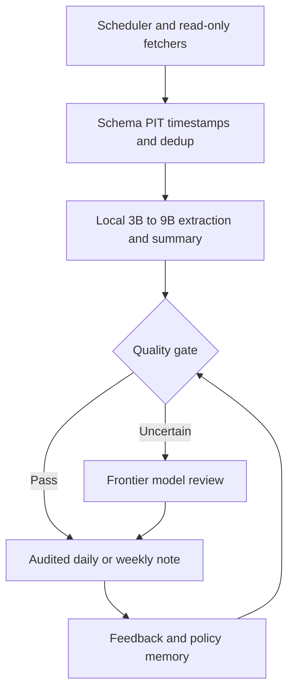

# HKUDS AgentPilot Deep Dive — 9B Policy Learning × Local-first Agent Infrastructure

**PResearch / Public Technical Research Note** · 2026-11-13 Asia/Shanghai · v0.1.0 · RESEARCH_ONLY / NOT_REPRODUCED

> Scope: Public HKUDS repository and Qwen model documentation only. This is an independent technical reading, not an endorsed HKUDS statement, paper review, or reproduced benchmark. No private conversation screenshots or personal data are included. Canonical private DD reference: `DD-TECH-20261113-001@v0.1.0` in `pengpengyi92/p-dd`.

## Executive Takeaways

1. The key contribution is **policy-level agent improvement**: a lightweight proposer plus UCB or textual memory can choose which candidate to improve, which direction to test, and when to stop. The system learns from executed feedback while keeping language-model weights fixed. This is *not* continuous gradient fine-tuning of a 9B model.
2. The published experiment specifies **Qwen 3.5 9B** for the policy proposer (temperature 0.3). The worker/solver may be a larger remote model; the Terminal-Bench 2.1 evolved agent uses DeepSeek V4 Flash 0731. The repository's "9B Strategy Model" marketing should not be interpreted as a separately released fine-tuned checkpoint without evidence.
3. A **9B model means around nine billion parameters**, not 9 GB. Approximate pure weight storage is 18 GB at FP16/BF16, 9 GB at 8-bit, or 4.5 GB at 4-bit, before quantization metadata and runtime memory. Actual GPU feasibility depends on context length, model format, framework and hardware.
4. The **63.8% vs 55.5%** README headline refers to average sampled seen/validation performance. On held-out C, Terminal-Bench Textual reaches **34/49 = 69.4%**, tying the separately reported best baseline ShinkaEvolve **34/49**; root task scores and search budgets differ. Do not claim causally equal-cost superiority.
5. For a personal research system, use a deterministic scheduler, official data APIs, local extraction/summarization, audit logging, confidence gates, cloud escalation, and human review. Add learned policy routing only when a controlled evaluation set exists.

## 1. What the project actually implements

- **Core / Shared Search State:** Version lineage, prior trials and remaining budget; D1 choose parent; D2 propose exploration/refinement direction; D3 choose action.
- **UCB policy:** Maintains per-arm selection statistics, allocating search between promising and uncertain options.
- **Textual/Memory policy:** Retains reusable lessons, applicability conditions and counter-evidence; can add, revise or retire lessons.
- **Agent Workspaces + OpenSpace:** Task execution, reusable skills, memories and previous evaluations. An agent's worker model, environment, access, and evaluator are independently configured.
- **RSI Arena:** Development A, feedback/validation B, sealed held-out C; keeps evaluation authority separate from editable agent code.

The large model is often the **execution/implementation worker**, whereas the 9B policy proposer is a decision component. A local-first personal agent *can invert that deployment pattern*—local routine execution and frontier-model supervision—but that is our suggested adaptation, not the project's existing benchmark claim.

## 2. Experiment reconciliation

| Benchmark | Evolved task-facing agent | AgentPilot proposer | Held-out AgentPilot UCB | Held-out AgentPilot Textual | Baseline best on separate panel |
|---|---|---|---:|---:|---:|
| AIME 2024+2025 | Terminus 2 + Qwen3.5 9B | Qwen3.5 9B (T=0.3) | 28/36 (77.8%) | 25/36 (69.4%) | ShinkaEvolve 25/36 |
| Terminal-Bench 2.1 | Terminus 2 + DeepSeek V4 Flash 0731 | Qwen3.5 9B (T=0.3) | 31/49 (63.3%) | 34/49 (69.4%) | ShinkaEvolve 34/49 |

The A/B/C sizes are AIME 6/18/36 and TB2.1 16/24/49. AgentPilot: 10 batches × 2 actions; baseline: 10 candidate occurrences. TB2.1 AgentPilot source root 22/49, separately run baselines root 27/49, so raw gains and scores need careful denominators. B samples can vary and replayed identical implementations may receive different scores. This is an insightful proof-of-concept for policy search, not a universal claim about model size or costs.

## 3. 9B size and local deployment

**Qwen/Qwen3.5-9B** is an open-weight model (Apache-2.0 per publisher model card), 32-layer hybrid linear/full-attention architecture and 262,144 native context-token specification. In practice, long contexts consume substantially more RAM/VRAM and attention/runtime overhead; don't assume a consumer 8GB GPU can host maximum context. A 4-bit GGUF is often approximately 5–6GB on disk; reserve memory for KV cache, compute buffers, tokenizer and OS. Quantization trades precision for capacity.

Local inference avoids a remote API's **per-token invoice**, but tokens still cost wall-clock time, GPU cycles and electricity. Cloud search/browser/data API access may remain metered. Use this break-even framework at a fixed report-quality target:

`TCO_local = (GPU + host + storage)/useful_months + power + administration + failure_recovery`

`TCO_cloud = paid_input_tokens + paid_output_tokens + tool/search fees`

`Hybrid savings = TCO_cloud_only - (TCO_local + escalated_cloud_calls)`

No numeric savings can be claimed before controlled measurement. AgentPilot itself is not automatically free when example configurations use remote workers/API credentials and paid inference limits.

## 4. Architecture for PFICC / PResearch

Suggested initial workload: official Treasury/Fed/BEA/BLS and exchange-rate sources for PFICC summaries; peer-reviewed/arXiv/RSS discovery with dates and links; public repository release/issue monitoring. Use Python for numerical facts and model(s) for language tasks. Network content is **untrusted**—do not let a web page instruct an agent to run shell commands, leak files, bypass robots/access rules or trade.

The policy-learning extension can select *which* source to revisit, *which* model to invoke, *which* report section needs verification, or *when* to escalate to a large model. It should not autonomously mutate source records or blindly optimize self-awarded scores.

## 5. Reproduction proposal (NOT_RUN)

Pre-register 30–50 public documents and a held-out chronological test slice. Four arms: (A) Python scripts only; (B) scripts + local 3B/9B; (C) cloud-only; (D) local-first router + feedback memory. Keep the same sources, exact output schema, traceability requirements and adjudication rubric.

Metrics: sourced-fact precision; correct numerical/date/unit extraction; citation coverage; severe-error rate; human correction minutes; completed-task ratio; p50/p95 latency; total cloud tokens and API spend; local VRAM/power; re-run stability; prompt-injection resilience. For an AgentPilot component specifically, test whether reward-driven policy transfers to unseen reports without degrading source fidelity. No trades or employer/customer data.

Stop/rollback if factual accuracy worsens, tasks lose provenance, the scheduler drifts, or the policy uses untrusted instructions as commands. A reproducibility finding requires pinned Git commit, model checkpoint revision, quantization, software versions, deterministic fixtures, and actual logs.

## 6. Five questions worth asking the researchers

1. Is the deployed 9B proposer **off-the-shelf Qwen3.5-9B**, a separately trained checkpoint, or role-specific prompting? Are checkpoint hashes and inference configs public?
2. Which portion of outcome improvement comes from UCB/Textual policy versus the proposer model, evaluator, search budget and selected task distribution?
3. Could a locally hosted proposer and worker be substituted independently of an OpenRouter connection?
4. How should a persistent agent learn from **non-stationary** information sources without contaminating held-out temporal tests?
5. What reward/quality gate would be suitable for citation-faithful daily research summaries, rather than coding-benchmark pass/fail?

## 7. Primary sources and caveats

1. [HKUDS/AgentPilot README](https://github.com/HKUDS/AgentPilot/blob/main/README.md) — authors' architecture and claims.
2. [RSI Arena protocol and observed results](https://github.com/HKUDS/AgentPilot/blob/main/arena/docs/evaluation.md) — exact denominators and comparative limitations.
3. [AgentPilot Arena integration](https://github.com/HKUDS/AgentPilot/blob/main/agentpilot/integrations/arena/README.md) — model routes, workers, Linux/Docker/bubblewrap and example execution budgets.
4. [OpenSpace README](https://github.com/HKUDS/AgentPilot/blob/main/openspace/README.md) — workspaces and evolving skills.
5. [Qwen official 9B model card](https://huggingface.co/Qwen/Qwen3.5-9B) — architecture, parameters, context and license.

**Evidence taxonomy:** source-owner declarations = direct documentation, not independent scientific replication; model size storage = arithmetic approximation; hybrid architecture = our proposed engineering design; report date = observation date, not publication date. All independent benchmarks **NOT_RUN**, financial/live uses **NOT_APPLICABLE**, overall research status **OPEN_EVIDENCE_GAPS**.
